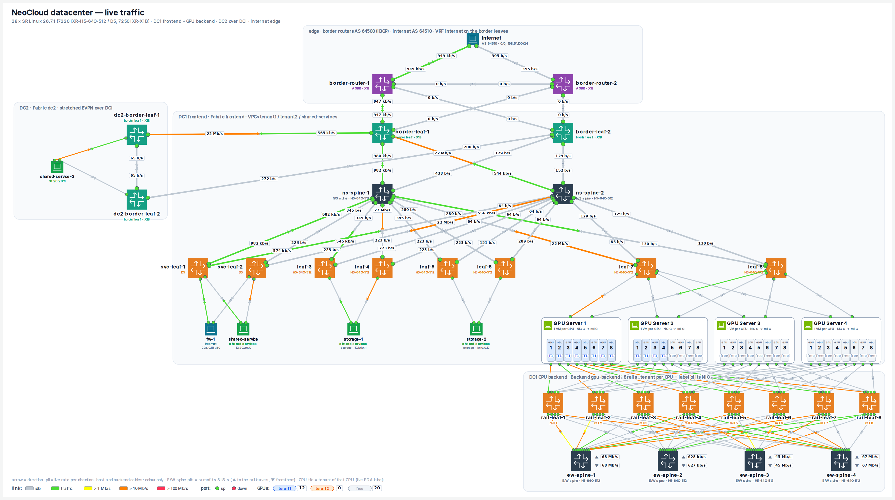

# NeoCloud: a GPU cloud datacenter on Nokia EDA

A complete demo lab for [Nokia EDA](https://docs.eda.dev) that shows how EDA runs the network of a GPU cloud
provider ("neocloud") on day 2 and after: onboarding a new tenant with its GPUs and network, keeping tenants apart,
sharing storage, internet access, monitoring, cabling checks and a hitless software upgrade of the whole fabric.

One script builds everything in an EDA namespace called `neocloud`: 28 simulated Nokia switches in two data centers, a
GPU backend, four GPU servers with eight GPUs each, storage, an internet edge, live dashboards and the demo tools. It all
runs inside EDA's own network simulator, so you need an EDA, not hardware.

## The lab at a glance



*The live Grafana map that the deploy builds, with the demo traffic running: every cable is coloured by its current
rate in each direction (grey idle, green traffic, yellow, orange and red for higher rates), and every GPU tile shows
the tenant that has booked it (T1 = tenant1, free = in the pool).*

| Part | Switches | Built by one EDA object |
|---|---|---|
| Data center 1 frontend | 2 spines, 6 leaves, 2 service leaves, 2 border leaves | Fabric `frontend` (eBGP underlay, EVPN overlay) |
| GPU backend | 8 rail leaves (GPU *n* of every server sits on rail *n*), 4 east-west spines | AI Fabrics Backend `gpu-backend` |
| Data center 2 | 2 border leaves, reached over two DCI links | Fabric `dc2`; both data centers share one EVPN domain |
| Internet edge | 2 border routers (AS 64500) peering with an internet router (AS 64510) | Virtual Network `internet` |

All 28 switches run SR Linux 26.7.1. The hosts are small Linux containers:

| Host | What it is | Address |
|---|---|---|
| GPU Server 1-4 | 8 GPUs each. Every GPU is its own little VM with a dedicated NIC to its rail leaf (backend) and a leg in its tenant's network (frontend, over the server's bond to two leaves). | per GPU, from its tenant |
| storage-1, storage-2 | shared storage, every tenant may use it | 10.10.10.11 / .12 |
| shared-service | a shared server (DNS, repository) in data center 1 | 10.20.20.10 |
| shared-service-2 | the same shared network, in data center 2 | 10.20.20.11 |
| fw-1 | a firewall in the internet network, public subnet | 203.0.113.130 |
| internet | an FRR router announcing 198.51.100.0/24 and 192.0.2.0/24 as "the internet" | 198.51.100.1 |

Every server is dual-homed to a leaf pair (EVPN multihoming, all-active), except the GPU NICs: one GPU, one rail.

**Tenants.** After a deploy the cloud has one tenant, **tenant1** (subnet 100.100.100.0/24, public, with internet),
holding 12 of the 32 GPUs: all of GPU Server 1 and GPU 1-4 of GPU Server 2. The other 20 GPUs are free. The demo
onboards **tenant2** (200.200.200.0/24) live.

Who reaches whom:

| From → to | tenant1 | tenant2 | storage + shared services | internet |
|---|---|---|---|---|
| tenant1 | yes | no | yes | yes |
| tenant2 (once onboarded) | no (yes only if tenant2 also gets internet: public to public) | yes | yes | only in its internet variant |
| storage + shared services | yes | yes | yes | no |

## What it demonstrates

1. **A whole datacenter from a handful of intents.** Two Fabric objects build the data center underlays and overlays,
   one AI Fabrics Backend builds the complete GPU backend (addresses, BGP, EVPN, one VRF per tenant, lossless RoCE QoS),
   and three Virtual Networks (internet, tenant1, shared services; tenant2 adds a fourth) carry every service. EDA
   turns them into the configuration of 28 switches.
2. **Onboarding a new tenant on a running fabric (the main story).** tenant2 gets its network, its GPUs, access to the
   shared services and its own read-only EDA login, three ways: by hand in the EDA GUI, undone again with one revert,
   then with Terraform (dry run at plan time, one transaction at apply, revert on destroy, or a merge request that a
   human approves). The switches end up identical either way. See [`tenant-onboarding/README.md`](tenant-onboarding/README.md).
3. **GPUs booked one by one.** A tenant books single GPUs, not whole servers. The tenant of a GPU is one label on its
   switch port (`backend=tenant1|tenant2`); without the label the GPU is free and its port is parked. Booking, moving
   or releasing a GPU is one label change: one EDA transaction, and the GPU has its addresses within seconds.
4. **Tenant isolation, with shared services.** Each tenant is its own VRF; tenants never see each other's routes,
   not even two GPUs of different tenants in the same server. Storage and shared services are reachable from every
   tenant through route leaking, which is not transitive, so tenants still cannot reach each other through them.
5. **Internet access without BGP to the tenants.** The border routers keep the full internet table and give the data
   center only a default route. That route is leaked into tenant1, and tenant1's public /24 is announced back out. A
   firewall sits in the internet network itself.
6. **Two data centers, one EVPN domain.** Data center 2 joins over two DCI links. The shared-services network spans
   both data centers (layer 2 and layer 3), and the DCI ports carry a complete MACsec configuration, administratively
   disabled because the simulator cannot encrypt.
7. **Monitoring and alerting.** A traffic threshold on every switch port raises EDA alarms; EDA's notifiers app sends
   every alarm to a small webhook receiver in the lab, standing in for Slack, Teams or a ticketing tool. Pull a cable
   and the receiver gets the root cause and every consequence, then a clear for each.
8. **Cabling checks.** EDA compares every LLDP neighbour with the topology. `./miswire.sh on` makes a server
   announce the wrong name, as if it were plugged into the wrong ports, and EDA raises an alarm that says exactly which
   cable is wrong. On-demand check workflows list every interface and BGP session.
9. **Upgrading the whole fabric in two halves.** One Deploy Image Pipeline moves all 28 switches between SR Linux
   26.7.1 and 26.7.2, one switch of every redundant pair at a time, with checks before and after each half. The
   frontend, data center and internet traffic loses about a second at most; a GPU's rail goes dark only while its own
   rail leaf is upgraded.
10. **Live views.** A Grafana map of the whole lab (the picture above) with live traffic on every cable and every GPU
    coloured by its tenant, and an EDA GUI dashboard, **NeoCloud Operations** (GPU capacity per tenant, tenant networks, backend
    health, isolation proof, alarms), with its own short navigation menu **NeoCloud**.

## What you need

**The EDA**

- Nokia EDA **26.8** in simulation mode (built and tested on 26.8.2). A Try EDA installation on Kind works.
- Room for the lab: its 38 simulator pods plus Prometheus, Grafana and the alert receiver request about 15 CPU and
  42 GiB of memory, on top of EDA itself. With EDA it comes to about 90 pods, within Kind's default limit of 110 pods
  per node.
- Internet access from the cluster: it pulls `ghcr.io/nokia/srlinux` (26.7.1, and 26.7.2 for the upgrade),
  `ghcr.io/srl-labs/network-multitool`, `quay.io/frrouting/frr`, Prometheus, Grafana and a Grafana plugin from
  grafana.com.

**An SR Linux 26.7 licence file.** Six switches (the border leaves, the border routers and data center 2) are
7250 IXR-X1B, a licensed platform even in the simulator, and EDA ships no SR Linux licence. Without your own licence
for SR Linux 26.7 those six switches stop at boot. The 7220 models need none. The script loads the file into the lab;
it is never copied anywhere else.

**Logins**

- The EDA URL or IP address, and an EDA admin user and password. If your EDA still asks for a new admin password at the
  first login, log in to the EDA GUI once before running the script.
- Keycloak (EDA's login server) must still have its install default `admin` / `admin`; the script needs it to read the
  secret of EDA's login client.
- A **kubeconfig** for the Kubernetes cluster EDA runs on, with cluster-admin rights. The script uses `kubectl` for
  what EDA's API cannot do: the network inside the simulated hosts, and the Grafana dashboard.

**Your machine** (Linux; run it where `kubectl` reaches the cluster, e.g. the Kind host)

- bash 4 or newer, `kubectl`, python3 3.9 or newer with PyYAML (`apt install python3-yaml` or `pip install pyyaml`).
- `jq` and `sshpass` for the node access tool `neocloud-ssh`.
- For the Terraform part only: Terraform 1.9 or newer and `curl`.

## Deploy

```bash
git clone https://github.com/kkayhan/neocloud.git
cd neocloud
./deploy.sh
```

The script asks for the following. Enter takes the default shown in brackets.

1. The EDA URL or IP address, the one you open in a browser, e.g. `10.1.2.3` or `https://eda.example.com:9443`.
2. The EDA admin user and password. The password is hidden; Enter takes `admin`.
3. The kubeconfig file of EDA's Kubernetes cluster, and the context to use if the file holds several.
4. The path of your SR Linux 26.7 licence file.

Then it runs a preflight and shows what it found:

- the EDA version on the Kubernetes side, and an API login as the admin;
- whether the kubeconfig and the URL point at the same EDA;
- the apps, the NodeProfile, the licence and the cluster capacity.

It changes nothing until you answer `yes`. A build from scratch takes 8 to 10 minutes on a Kind cluster and ends with a
full check of the lab (`verify.sh`) that reports `ALL PASS`. Then open:

- the EDA GUI, namespace `neocloud`; in the menu drop-down at the top of the left menu, pick the panel **NeoCloud**;
- the live map: `<EDA URL>/core/httpproxy/v1/neocloud-grafana/d/neocloud-topology/` (no login).

The answers, but never the password, are saved in `.state/`. Later runs offer them as defaults, and every demo tool
below uses them to reach the same EDA. Each run writes a log to `.state/deploy-<time>.log`.

Running `./deploy.sh` again on a deployed lab updates it in place. Single phases, for example after a change or a
simulator pod restart:

```bash
./deploy.sh --phase hosts      # network config inside the simulated hosts (lost when their pods restart)
./deploy.sh --phase grafana    # the Grafana map
./deploy.sh --phase verify     # the full check
```

Phases: `ns users topology fabrics backend edge vpcs macsec hosts grafana dashboard monitoring upgrade verify`.
`all` (the default) runs them in that order; `topology` deletes and rebuilds the switches.

**Unattended runs.** Every answer can come from the environment: `EDA_URL`, `EDA_ADMIN_USER`, `EDA_ADMIN_PASSWORD`,
`NC_KUBECONFIG`, `NC_CONTEXT`, `NEOCLOUD_LICENSE`; `--yes` skips the confirmation; `KC_MASTER_USER` and
`KC_MASTER_PASSWORD` override the Keycloak admin.

## What it creates on the EDA

- **Inside EDA namespace `neocloud`** (Kubernetes namespace `neocloud` too): the topology (28 switches and 10 simulated
  hosts, the internet router included) and its pools, the Fabrics, the Backend, the Virtual Networks and routing
  policies, two Configlets (DCI MACsec, and an ESI setting the X1B needs), the monitoring objects, the NodeProfile for SR Linux
  26.7.2, the alert receiver, and Prometheus + Grafana for the map.
- **Outside the namespace:**
  - in `eda-system`: the licence ConfigMap `neocloud-srl-sim-license`, HttpProxy `neocloud-grafana`, three Exports
    `neocloud-*`, TopologyGrouping `neocloud-tiers` (spine/leaf tiers in EDA's topology view), the Artifact
    `srlinux-ghcr-26.7.2` and the PipelineDefinition `neocloud-upgrade-pipeline`;
  - Nokia's own `deployimage-pipeline` is kept disabled (EDA ships it disabled), so that an image upgrade runs only the
    lab's pipeline; if you had enabled it, the deploy turns it off;
  - the EDA user `terraform` (group system-administrator), used by the Terraform part;
  - the shared GUI dashboard **NeoCloud Operations** and navigation panel **NeoCloud**, visible to every EDA user;
  - the Prometheus Exporter and Notifiers apps, only if they were missing.

## Remove

```bash
./destroy.sh
```

This deletes everything listed above except the two apps and the 26.7.2 Artifact, which others may use; Nokia's
`deployimage-pipeline` stays disabled, as EDA ships it. It takes about a minute and a half. It may show a few FAILED transactions in the EDA
GUI while the switches go away; that is harmless.

## Running the demo

Every tool uses the connection saved by `./deploy.sh`; run them from the repository folder.

| Command | What it does |
|---|---|
| `./verify.sh` | The full check, any time: fabrics, backend and virtual networks up, every link and BGP session, a ping matrix of the frontend and of the GPU backend against the expected isolation, internet, DCI, an alert test and EDA's own check workflows. Its expectations follow the live GPU bookings and tenant2's state, so it passes in every state of the demo. |
| `./neocloud-ssh -l` | Every node with its role. `./neocloud-ssh leaf-3` opens the SR Linux CLI (admin / NokiaSrl1!), `./neocloud-ssh storage-1` a host shell, `./neocloud-ssh gpu-server-2/gpu5` the shell of GPU 5 of GPU Server 2. `-c 'CMD' NODE` runs one command; `--all-switch`, `--fabric frontend`, `--role borderleaf` run it on a group; `--gpus` lists all 32 GPUs with tenant and addresses. |
| `python3 traffic/neocloud-traffic.py start` | Background traffic for the dashboards: GPU to GPU across rails per tenant, storage traffic, data center 2 to 1, and a stream to the internet. `status`, `stop`. Run `start` again after onboarding tenant2. It exceeds the port alarm limits on purpose, so traffic alarms appear while it runs. |
| `bash hosts.sh --follow` | Keeps the GPU VMs in line with their port labels: whenever a GPU is booked, moved or released (GUI, kubectl or Terraform), it sets up that GPU's addresses. Leave it running in a terminal during the demo. |
| `.state/kubectl -n neocloud logs -f deploy/alert-sink` | The alert receiver: one line per notification EDA sends, with a link into the EDA GUI. |
| `./miswire.sh on` / `off` | The cabling mistake: storage-2 announces itself as storage-1. An LLDP alarm follows within about half a minute, and clears about half a minute after `off`. |
| `bash upgrade/run.sh 26.7.2` / `26.7.1` | Upgrades or downgrades all 28 switches (about 17 minutes each way) and prints the traffic report. `python3 upgrade/traffic.py watch` shows the flows live. |
| `bash tenant-onboarding/demo-reset.sh` | Back to the starting point after the tenant onboarding, however tenant2 was made. |

### Suggested walk-through

1. **The intents.** In the EDA GUI, NeoCloud panel → Fabrics: `frontend` and `dc2`; AI Backends: `gpu-backend` (it
   derives its own two fabrics, one for the rail leaves and one for the east-west spines). Open one and show the YAML:
   that is the whole input for its switches. Topologies → Physical, grouping **NeoCloud tiers**, shows the lab in tiers.
2. **The operations dashboard.** NeoCloud → NeoCloud Operations: 12 GPUs booked, 20 free, every switch in sync, the
   isolation table proving that each tenant VRF holds only its own subnet plus the shared services. Start
   `python3 traffic/neocloud-traffic.py start` and the traffic tiles and the Grafana map light up.
3. **Onboard tenant2 by hand.** Follow the click list in [`tenant-onboarding/README.md`](tenant-onboarding/README.md):
   four new objects, two small edits, four GPU labels. Commit, run `bash hosts.sh gpu-server-2`, and show the
   result: on the dashboard tenant2 appears with 4 GPUs; `./neocloud-ssh -c 'ping -c2 10.10.10.11' gpu-server-2/gpu5`
   reaches storage; the same GPU cannot reach tenant1 (`ping -c2 100.100.100.111`).
4. **Revert it.** Transactions → the onboarding transaction → Revert. tenant2 is gone from every switch.
5. **Onboard tenant2 with Terraform.** `cd tenant-onboarding/terraform && bash setup.sh`, then `terraform plan -var gpus=4`
   (EDA dry-runs it and shows the switch configuration), `terraform apply -var gpus=4`, grow it with
   `-var gpus=6` (only the two new GPUs change), try `-var delivery=merge-request` for four-eyes approval, and finish
   with `terraform destroy`.
6. **Book a GPU by hand.** With `bash hosts.sh --follow` running, give free GPU 7 of GPU Server 3 to tenant1:
   in the GUI, Interfaces → `rail-leaf-7-ethernet-1-3` → add label `backend=tenant1` (or
   `.state/kubectl -n neocloud label interfaces.interfaces.eda.nokia.com rail-leaf-7-ethernet-1-3 backend=tenant1`).
   One transaction later the GPU has its addresses and its tile on the Grafana map turns blue. Remove the label to
   release it.
7. **Internet and the edge.** `./neocloud-ssh -c 'ping -c2 198.51.100.1' gpu-server-1/gpu1` works for a tenant1 GPU,
   the same from `storage-1` does not. `./neocloud-ssh -c 'show network-instance tenant1-vrf ipv4 route 0.0.0.0/0' border-leaf-1`
   shows the default route leaked in from the internet VRF.
8. **Two data centers.** `./neocloud-ssh -c 'ping -c3 10.20.20.10' shared-service-2` crosses the DCI at layer 2 and
   lights up the DCI links on the map. `./neocloud-ssh --role borderleaf -c 'info transport-security macsec'` shows
   the MACsec configuration.
9. **Alarms.** Watch the alert receiver, then cut a link: `./neocloud-ssh -c 'ip link set eth1 down' internet`, and
   `up` again 30 seconds later. Then `./miswire.sh on` for the cabling alarm.
10. **The fabric upgrade.** In the GUI: Workflows → Deploy Image Pipeline → Create, Node Profile `srlinux-ghcr-26.7.2`,
    tranche `tranche-a` with selector `upgrade-group=a`, then `tranche-b` with `upgrade-group=b`, no canary, and a new
    name for every run. Or run `bash upgrade/run.sh 26.7.2`, which also measures the traffic. Go back with `26.7.1`.

## Notes

- The simulator forwards real packets but never congests, so the RoCE QoS (ECN, PFC) shows in the configuration, not
  in the counters. MACsec is configured but administratively disabled: in the simulator an enabled MACsec port stops
  forwarding.
- SR Linux 26.7.1 is newer than the releases EDA 26.8.2's apps officially list; it works in the simulator.
- The network config of a simulated host lives in its pod. If a host pod restarts, run `./deploy.sh --phase hosts`.
- All simulators on one Kubernetes node share the node's ARP table, which Linux limits to 1024 entries by default.
  This lab adds about 600. On a small single-node cluster (Kind) run it next to nothing else of that size, or raise
  `net.ipv4.neigh.default.gc_thresh3` on the node.
- An EDA digital twin (Branch) of this lab does not boot its switches on its own: a Branch does not copy the licence
  ConfigMap the switches' NodeProfile points to.
